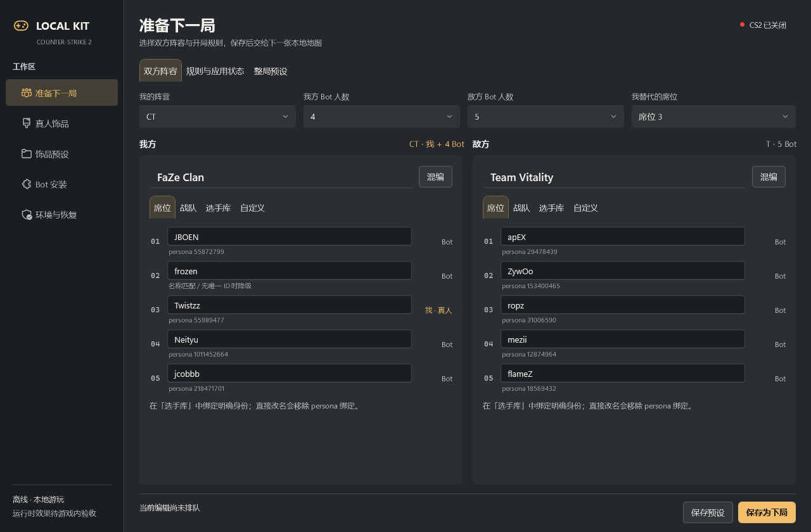
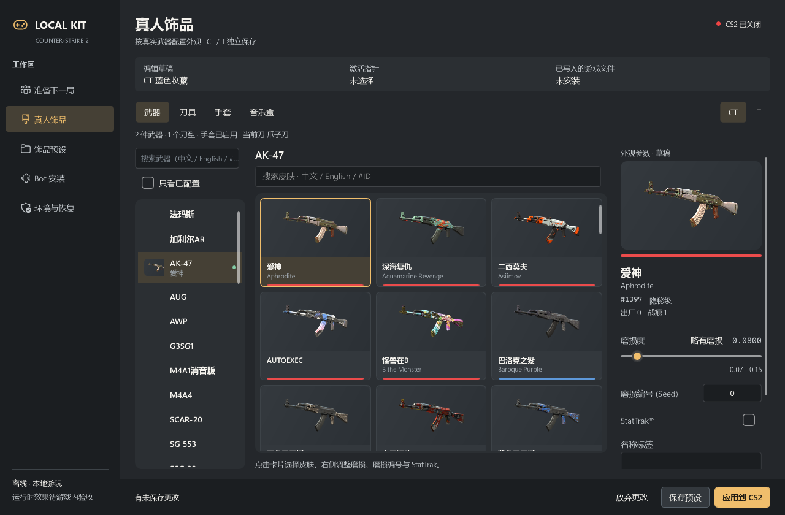
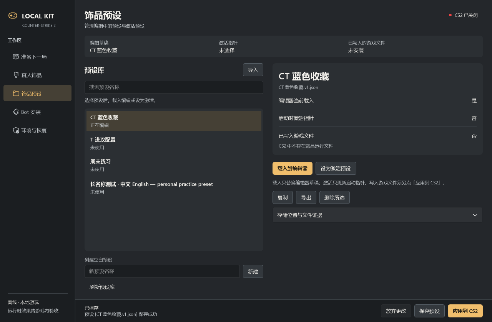
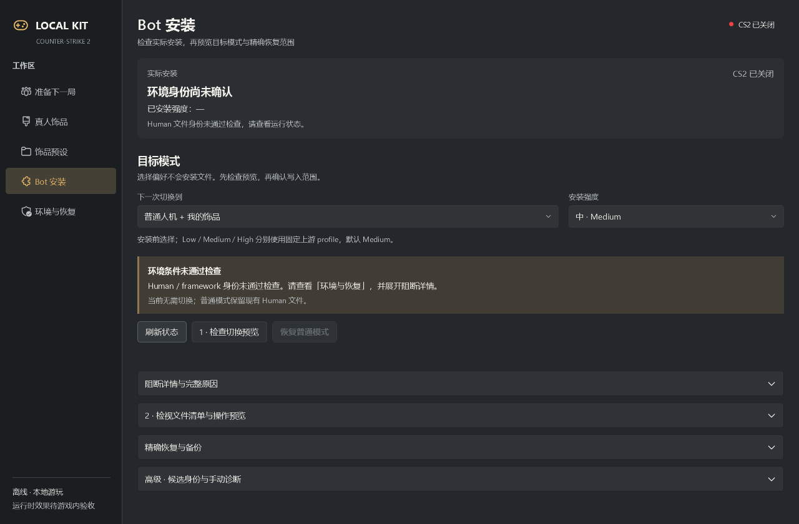
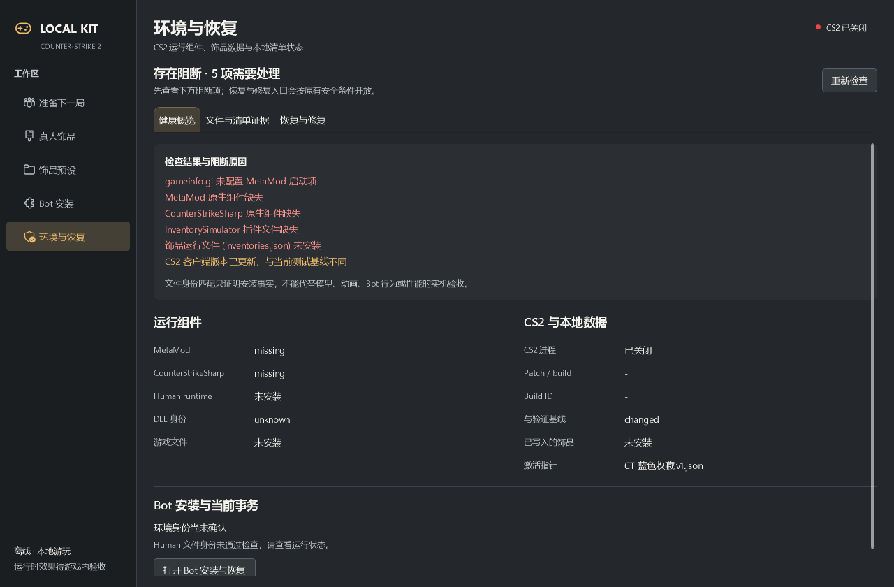

# Controller UI/UX redesign — 2026-10-22

本轮交付重新组织整个 WPF Controller：准备下一局、真人饰品、饰品预设、Bot 安装、环境与恢复。已完成实际 WPF 渲染和隔离交互检查；**不代表 D 阶段 Bot + Human 游戏内验收通过**。

- 起点：`codex/match-setup-20261022` / `e6b7f4afa3614ab2178f17f6efd99e12d395e856`。
- 任务分支：`codex/controller-redesign-20261022`。
- 产品实现提交：`7c50e7a`；发布源码提交：`822155c8b2ee795f0b061c6946b9d3df70cf3165`。随后仅归档证据，不更改发布代码。
- 工作树：`E:\Projects\CS2-Local-Kit\wt-controller-redesign-20261022`。
- 独立 self-contained win-x64 release：`E:\CS2MOD\releases\controller\controller-redesign-20261022-822155c`；入口 `payload\CS2LocalKit.App.exe`。旧 release 未覆盖。

## 交互与信息架构

原来的长人机页面同时堆放阵容、选手搜索、预设、安装与恢复。现在日常开局准备与文件操作分开：双方阵容并排，席位 / 战队 / 选手库 / 自定义为独立入口；规则与应用状态、整局预设各有工作区，保存为下局固定在底部。席位显示真人替代与不出场状态，选手库展示明确 persona / disabled，搜索变化会清除旧的替换选择，个人阵容也参与队伍搜索。

真人饰品保留适合此任务的型号 → 外观 → 参数浏览模式，统一 Fluent 输入、选择与滚动，窄窗按可用宽度减少卡片列数。编辑草稿、激活指针、已写入文件分别呈现；保存、激活、应用各走原命令。Human 应用新增显示预设与目标的确认，取消不写文件。未保存切换使用明确的保存 / 放弃 / 取消按钮。

预设库采用搜索列表与详情，空结果有返回路径。Bot 安装单列实际安装、目标偏好、检查预览和确认；精确恢复入口保留。健康页先给状态、阻断项和可操作原因，路径 / hash / 候选完整错误移入二级证据。Core、Bot/Human runtime、installer、schema、正式 locks 和当前候选没有修改。

## 真实设计参考与组件选择

先读取并查看了下列官方界面截图，原始参考图仅存于任务 `temp/design/references`，没有复制竞品素材进产品：

| 参考 | 实际采用的模式 |
| --- | --- |
| [WPF UI Gallery](https://wpfui.lepo.co/) / [官方界面图](https://wpfui.lepo.co/images/wpfui-gallery.png) | 文字导航、Fluent 图标、低干扰工作表面、统一控件与焦点基础 |
| [VS Code UI](https://code.visualstudio.com/docs/getstarted/userinterface) | 浏览、编辑和详情分区，保留任务上下文，诊断从主要工作区分离 |
| [OBS 官方界面与设置](https://obsproject.com/kb/obs-studio-overview) | 稳定任务分类、分组设置、明确确认与操作后果 |
| [Fluent Windows](https://fluent2.microsoft.design/components/windows) | 原生控件预期、清楚的状态、紧凑而有秩序的层级 |

主体系选用 [WPF-UI 4.3.0](https://www.nuget.org/packages/WPF-UI/4.3.0)：实际还原并构建 `net10.0-windows`，发布携带其程序集。使用其控件字典、输入 / 选择器 / 列表 / Tabs / Expander / 滚动基础和 SymbolIcon；仅对导航、外观卡片、主操作做有限专用样式，不引入第二个重型主题。MIT license 与上游 third-party notices 一起随 payload 发布。

另实际评估 [MaterialDesignThemes 5.4.0](https://www.nuget.org/packages/MaterialDesignThemes/5.4.0)（MIT、支持 net8+，Material 空间与视觉语言不作为本轮 Windows 工具主体系），以及 [ModernWpfUI 0.9.6](https://www.nuget.org/packages/ModernWpfUI/0.9.6)（NuGet 标记 legacy / unsupported；[1.0.0-rc.1](https://www.nuget.org/packages/ModernWpfUI/1.0.0-rc.1) 仍为 prerelease）。没有混装。

基础 tokens：暖灰 `#24272B` 工作区、`#1B1E21` 侧栏、琥珀 `#F0BE6C` 主操作；13 DIP 正文、12 DIP 次级文字、24 DIP 页标题，Segoe UI / Microsoft YaHei UI fallback，4/8 间距节奏。状态同时用文字表达，不能只靠颜色判断。

## 实际工具盘点

检查了 `D:\skills`，包括 frontend-design、ui-ux-pro-max 和 Figma prototype 类资源；使用 `personal-ui-delivery` 核对状态/命令映射，使用 `agent-reach` 做参考访问。Exa 免费额度用尽，Jina 未返回可用正文，降级到官方页面与官方图片直读。Agent Reach 版本检查为 v1.5.0 / latest，未执行更新。

Figma MCP `whoami` 成功，当前为 Starter/View，code layers / specs 不可用；无现成目标文件，因此不创建与真实 WPF 脱离的云端原型。Mobbin 查询返回 paid-plan requirement，未购买。常见安装位置未发现 Figma Desktop / Inkscape，也没有相关 CLI / winapp；没有为了验证启动设计软件、浏览器窗口或安装全局工具链。系统 dotnet 无 SDK，使用既有 task-local SDK 10.0.401 和 PowerShell 7。

## 验证与实际视觉修正

- 完整既有 .NET 测试加本轮确认测试：**254 passed / 0 failed / 0 skipped**。
- [UiProbe 源码与执行边界](../../tests/CS2LocalKit.UiProbe/README.md)：**69 项检查，其中 34 项为 PNG 非空 / alpha 校验，另 35 项为交互及隔离约束**。Value / SelectionItem / Invoke / RangeValue / ExpandCollapse providers 在进程内实际执行。
- 阵容搜索 / persona 替换 / disabled 阻断 / 空结果 / 自定义持久化 / 保存与排队分离 / dirty 快照分离；CT/T 与分类选择 / 磨损修改 / Human 保存 / 应用取消 / 预设激活；安装、恢复和修复 gates 均有探针断言。
- 1024×660、1280×840、1440×900、1600×940 内容面；另加 1000×610 保守覆盖最小窗口扣除原生 chrome 后的客户区。WPF root DPI 实际执行 96 / 120 / 144，PNG 尺寸匹配；隐藏 HWND 实测 native DPI 为 144。
- 第一轮截图发现了资源基类解析、过长的阵容表单、无标签搜索、未自然触发图片 Loaded、旧选中色和主页面暴露完整路径等问题，集中修正后确认。后续用真实 release 程序集和同一套检查收口；没有继续扩大到 runtime 修复。
- **发布文件验证**：将完整 payload 复制到任务 scratch，以 probe apphost 配合发布的 `.deps.json` / `.runtimeconfig.json` 加载其本地 self-contained runtime。实际加载的 `CS2LocalKit.App.dll` SHA256 与发布文件完全一致：`6c83a0eb03d201d27072d5de31c859039fddc4dd836b921cb98b74c96ed808c8`。因此截图对应发布程序集。未执行会调用 `Window.Show` 的正常 `App.OnStartup`。
- 发布清单包含 **408 文件**，现有 private-data gate 通过。检查 **674 个**受保护的预设、指针、事务/备份记录、相关游戏文件，路径、长度与 SHA256 前后相同。原始保护清单含个人数据路径，只保留在本地，不提交。
- [机器可读验证摘要](2026-10-22-controller-redesign/verification.json)。完整 34 PNG、TRX、探针报告和设计决策在 release 的 `evidence/`，不包含用户个人预设。

整个探针没有 `Window.Show`、全局鼠标/键盘注入、剪贴板写入、Explorer 或前台切换。使用 (-30000,-30000) 的 1×1 自有 HWND，无 `WS_VISIBLE`，带 `WS_EX_NOACTIVATE | WS_EX_TOOLWINDOW`；前后均检查不可见。前台进程前后也均不是探针进程；用户可以继续正常操作自己的桌面。探针结束后关闭/释放自有窗口与 HWND，进程退出。

## 代表性真实 WPF 截图

以下都是合成预设 / 隔离环境；战队、persona、固定清单和缓存图片来自实际数据。不是当前机器活动安装的健康报告。

双方阵容与真人替代：

饰品浏览、参数与独立状态：

预设库：

安装与阻断反馈：

健康概览：

另见 [窄窗](2026-10-22-controller-redesign/match-1024.png)、[选手搜索](2026-10-22-controller-redesign/players-search.png)、[排队与内部状态](2026-10-22-controller-redesign/match-status-pending.png)、[清单缺失](2026-10-22-controller-redesign/catalog-unavailable.png)、[确认界面](2026-10-22-controller-redesign/confirmation.png)。

## 保留的人工验收

RenderTargetBitmap 证明实际 WPF Visual 树，不能当成原生桌面合成截图。进程内 UIA provider 不等于跨进程桌面输入测试。原生 ComboBox Popup、文件对话框、标题栏、模态窗口激活、真实键盘 / 鼠标 / hover / 焦点、物理多显示器 DPI 迁移未进行，避免干扰用户桌面。

没有启动 CS2，没有真实 Install / Restore，没有修改活动事务 `b613a8c709c7440998346cb802bb790f` 或其备份，没有提升 runtime locks。**D 阶段实机 Bot / Human 模型、动画、TAB、score、换边、Aim/Nades 与性能仍为 pending。**
